# الجدول على iPhone Duo — الامتداد الكامل والتكيّف بالمساحة (13 نوفمبر 2026)

نطاق هذه الجولة طبقة العرض وحدها: ملفات CSS في `src/styles/` وسطر استيراد في `src/index.css`. لم يُمَسّ الخادم ولا الدخول ولا الصلاحيات ولا Firestore ولا ملفات النشر ولا التقارير المطبوعة (`08-print.css`).

رموز الحالة: `PASS` تحقق مُشاهَد أو مُقاس، `PARTIAL` جزئي، `FAIL` خلل باقٍ، `BLOCKED` يحتاج جهازاً أو إذناً، `NOT_APPLICABLE` غير ذي صلة، `NOT_TESTED` لم يُختبر.

## 1. خط الأساس قبل التعديل (`origin/main`)

| الفحص | النتيجة |
|---|---|
| `npm ci` | PASS |
| `npm run lint` (`tsc --noEmit`) | PASS |
| `npm test -- --quick` | 275 من 279. الأربعة الفاشلة اختبارات زمنية وHTTP على جهازٍ حمله أكثر من 180 (`demo-every-role` وفيه «الدخول التجريبي أقل من ست ثوانٍ» 10.2s، و`demo-radar` و`registration-flow` و`unchanged-request-http`). CI على `main` أخضر للكود نفسه، فهي من بيئة التشغيل لا من الكود |
| `vite build` + حزمة الخادم | PASS |
| مصفوفة WebKit (14 مقاساً × 7 شاشات) | لا تمرير أفقي، ولا أخطاء JS من الصفحة. العيوب في القسم 2 |

## 2. ما وُجد وما أُصلح من جذوره

| # | العَرَض (قبل) | الجذر | الإصلاح |
|---|---|---|---|
| 1 | القرص بإصبعين للتكبير ممنوع فعلياً على كل شاشة لمس، مع أن `main.tsx` و`index.html` يقرّران أن التكبير لا يُمنع أبداً. القياس: `touch-action` للجذر = `pan-x pan-y` | بقيةٌ قديمة في `07-responsive.css`: `html,body,#root{touch-action:pan-x pan-y!important}` لكل مؤشر لمس، وتعليقها يقول إن `pinch-zoom` «غائب عمداً» | صارت `pan-x pan-y pinch-zoom`. يبقى التمرير بإصبع كما هو، ويبقى التكبير باللمس المزدوج معطّلاً عبر `manipulation` على الأزرار. القياس بعد: `pan-x pan-y pinch-zoom` في كل مقاسات اللمس، و`manipulation` على الحاسوب كما كان |
| 2 | في الارتفاع المضغوط (الدوو مطوياً أفقياً 594×368 و600×350، ومفتوحاً عرضياً مع نافذة مثبتة 951×350، والآيفون أفقياً 844×390) يأخذ الشريط العلوي 64px والسفلي 59px، أي 123px من 350–368 (ثلث الشاشة) | الارتفاعان ثابتان، ولا يوجد «صنف حجم» للارتفاع القصير | كتلة `(max-height:480px)` في `55-duo-adaptive.css`: `--topbar-h:50px` (والجرس يحسب موضعه منه فيبقى في الشريط)، والشريط السفلي أيقونته بجانب اسمه بارتفاع 49px، وكل زر ما زال ≥44px. صار المجموع 99px. لوح الجدول العائم يقف فوق الشريط بـ`var(--dock-h)` لا بـ70px ثابتة |
| 3 | الهاتف أفقياً، وشاشة الدوو الخارجية حين يقطعها عمود Safari أو الكاميرا: أول السطر يدخل تحت الفتحة | حشوة المحتوى قيمة واحدة (`--gutter`) للجهتين لا تعرف `safe-area-inset-left/right`. الشريطان كانا يعرفانها، والمحتوى لا | تحت 1120px: `padding-left:max(var(--gutter),env(safe-area-inset-left))` ومثلها لليمين على `.app-main`. الخلفية ممتدة من حافة لحافة، والمحتوى وحده يبتعد. وصفحة الدخول في الوضع الأفقي وعلى الهاتف تأخذ الحافتين الجانبيتين كذلك. حين تكون الحواف صفراً لا يتغير شيء بصرياً |
| 4 | `100vh` في غلاف التطبيق و`body` وشاشة التحميل، وفي أوراق ملء الشاشة على الهاتف (تقرير PDF، ورقة الاجتماع، ورقة الفجوات، لوحة الإشعارات): على iOS هو الارتفاع الأكبر، فيختفي أسفل الورقة تحت شريط Safari | وحدة الارتفاع | أُضيف `100dvh` بعد كل `100vh` (يبقى `100vh` احتياطاً للمحركات القديمة) |

ما فُحص ولم يحتج تعديلاً: قرار «مساحة عمل الهاتف» في `src/utils/workspaceSize.ts` يحكم بعرض الصفحة وارتفاعها لا بـ`screen.*`؛ ولا يوجد `user-scalable=no` ولا `maximum-scale`؛ والمسار المجهول يعرض الرئيسية (لا شاشة 404 مستقلة)؛ وكتل `viewport-segments` من الجولات السابقة (`47-duo-open-workspace.css`) باقية كما هي.

## 3. فحص الامتداد الكامل

| البند | الحالة | الدليل |
|---|---|---|
| خلفية الجذر | PASS | `body` يحمل `--canvas`، و`.app-shell`/`.app-main` بـ`100dvh`. الخلفية تمتد حتى الحواف في كل اللقطات |
| حواف الأمان | PASS (مراجعة كود) | الشريط العلوي والسفلي والمحتوى كلٌّ يأخذ جهته. Playwright WebKit يعيد الحواف صفراً دائماً، فلم تُقَس أرقام غير صفرية |
| تمرير أفقي | PASS | 0 في 98 حالة (14 مقاساً × 7 شاشات) قبل وبعد |
| أخطاء JS | PASS | 0 بعد التعديل على البناء الإنتاجي |
| لوحة المفاتيح | NOT_TESTED | المحاكاة لا تظهر لوحة مفاتيح حقيقية |

## 4. مصفوفة الوضعيات A–J

المنصة: Playwright WebKit (build 2370) بملف Safari المحمول (UA الدوو، لمس، DPR 2، تقليل الحركة)، على بناء إنتاجي محلي بالوضع التجريبي. الشاشات: الرئيسية، الجدول الدراسي (`/FSchedule/Index`)، مركز الاستعلام والجدول (`/FSchedule/MainReport`)، مركز الذكاء، المقررات، آلة الزمن، ومسار مجهول.

| الوضعية | المقاس | النتيجة | الحالة |
|---|---|---|---|
| A مطوي طولي | 382×580 | لا تمرير، الشريطان واللوح العائم في أماكنها | PASS (محاكاة) |
| B مطوي عرضي | 594×368 و600×350 | الأشرطة 99px بدل 123px، ولوح الجدول فوق الشريط | PASS (محاكاة) |
| C مفتوح طولي | 669×867، ومع نافذة مثبتة 669×520 | تخطيط الهاتف الكامل العرض، والجدول والتقرير بلا تمرير أفقي | PASS (محاكاة) |
| D مفتوح عرضي | 951×585، و951×350 | مساحة العمل الكاملة، وفي 350 الأشرطة الأنحف | PASS (محاكاة) |
| E كتاب | مفصل عمودي | كتل `horizontal-viewport-segments` من جولة سابقة تقسم التنقل والعمل على الشاشتين. لم تُختبر في هذه الجولة، وفي Safari 27.1 الـ API خلف علم | BLOCKED على الجهاز |
| F طاولة | مفصل أفقي | لا كتلة مخصصة، والصفحة قابلة للتمرير | BLOCKED على الجهاز / NOT_TESTED |
| G نافذتان | 385×571 | ✓ | PASS (محاكاة) |
| H Split | 320 / 470 / 620 ×600 | ✓ | PASS (محاكاة) |
| I خيمة/حامل | — | لا runtime يعلن الوضعية | NOT_TESTED |
| J انتقال حي | 951→669→470→382→594→951 بلا إعادة تحميل | المسار باقٍ، والنص المكتوب في «بحث سريع» باقٍ، ولا إعادة تحميل (علامة في `window` بقيت)، ولا تمرير أفقي. كان ناجحاً قبل التعديل وبقي | PASS |

مقاسات إضافية: آيفون 390×844 و844×390، وسطح المكتب 1440×900. سطح المكتب لم يتغير (كل الكتل الجديدة تحت 1120px).

## 5. صور قبل/بعد

| الحالة | قبل | بعد |
|---|---|---|
| B مطوي عرضي 594×368، الجدول | 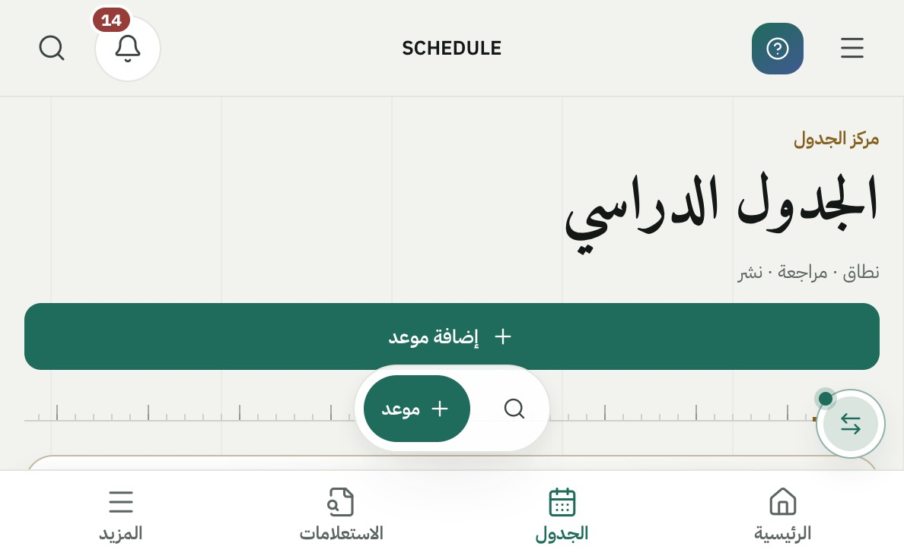 | 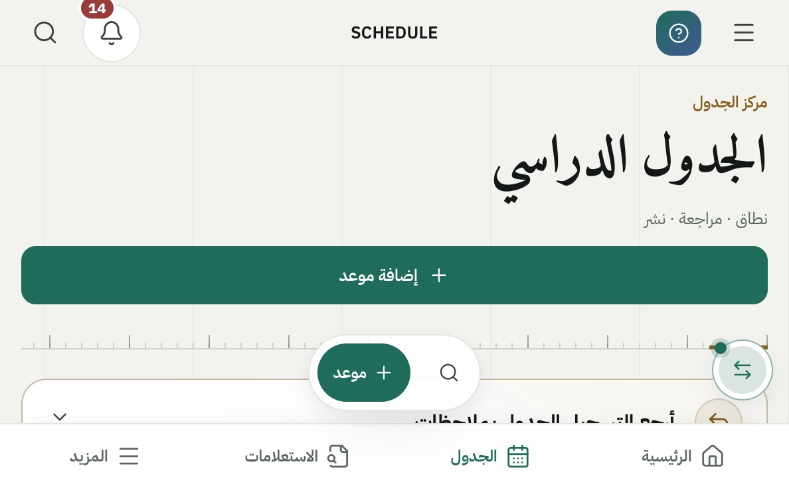 |
| B مطوي عرضي 600×350، الرئيسية | 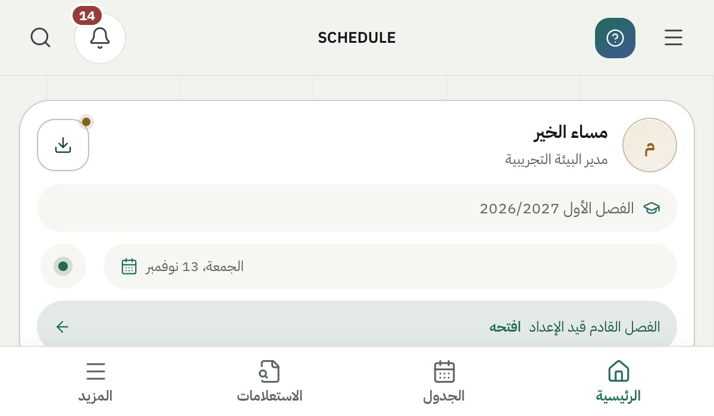 | 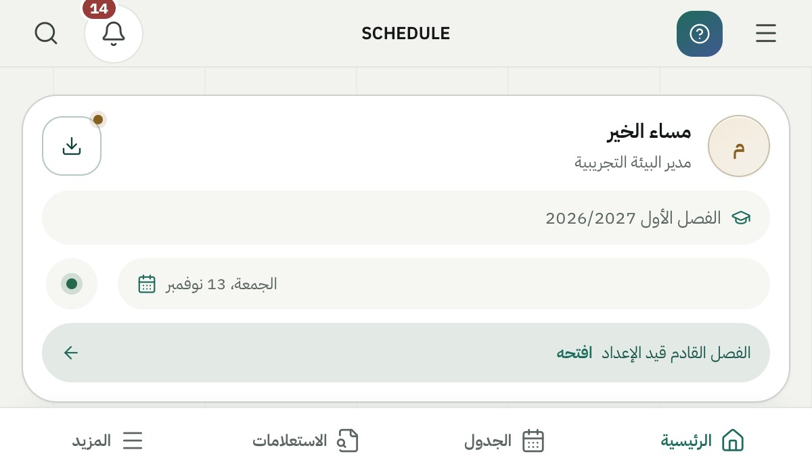 |
| آيفون أفقي 844×390، الجدول | 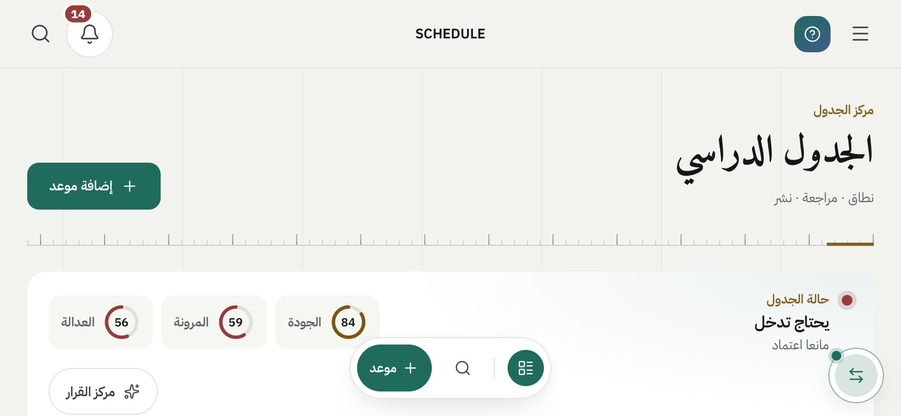 | 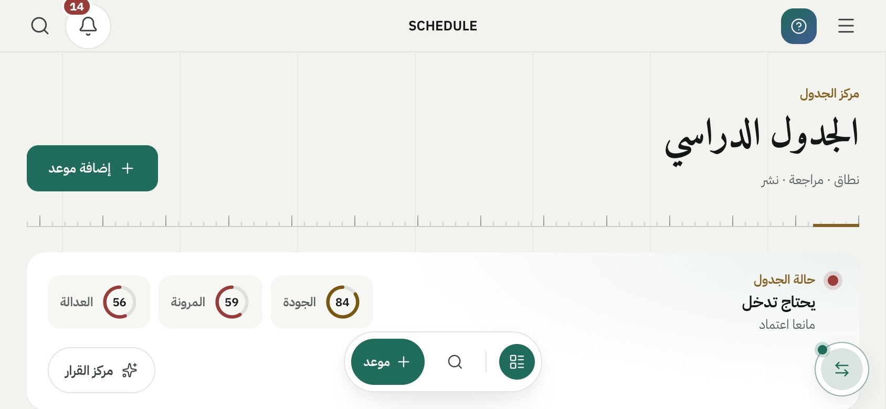 |
| A مطوي، C مفتوح طولي، D مفتوح عرضي (بعد) | 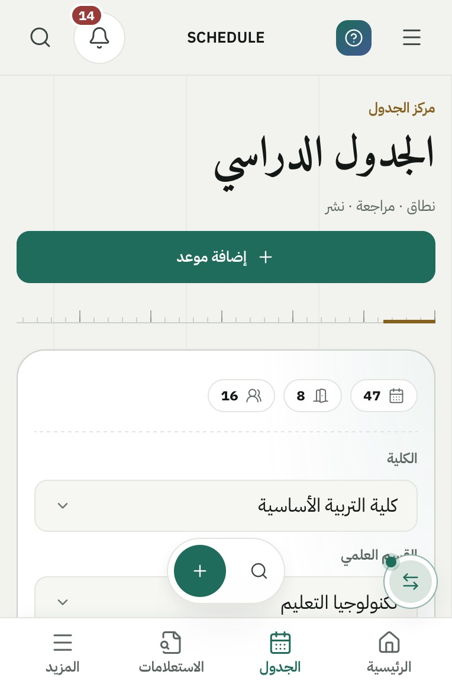 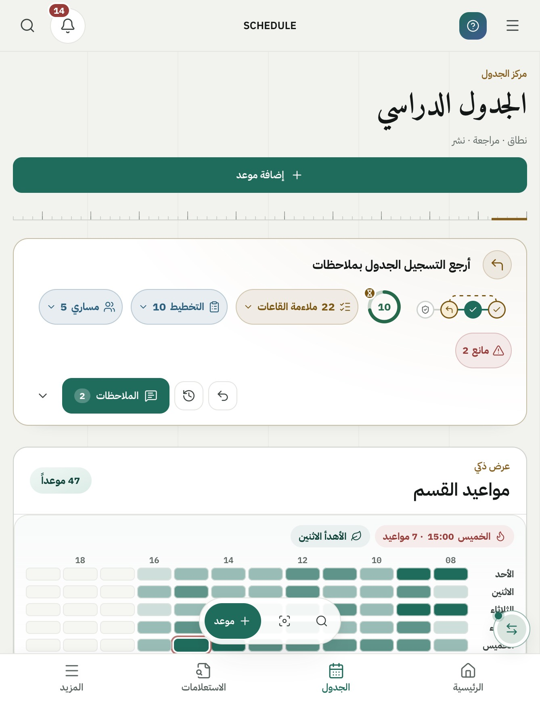 | 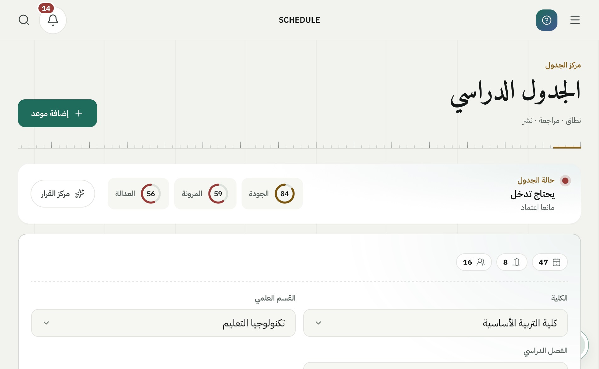 |
| H 470، مركز الاستعلام؛ C مع نافذة مثبتة، مركز الذكاء (بعد) | 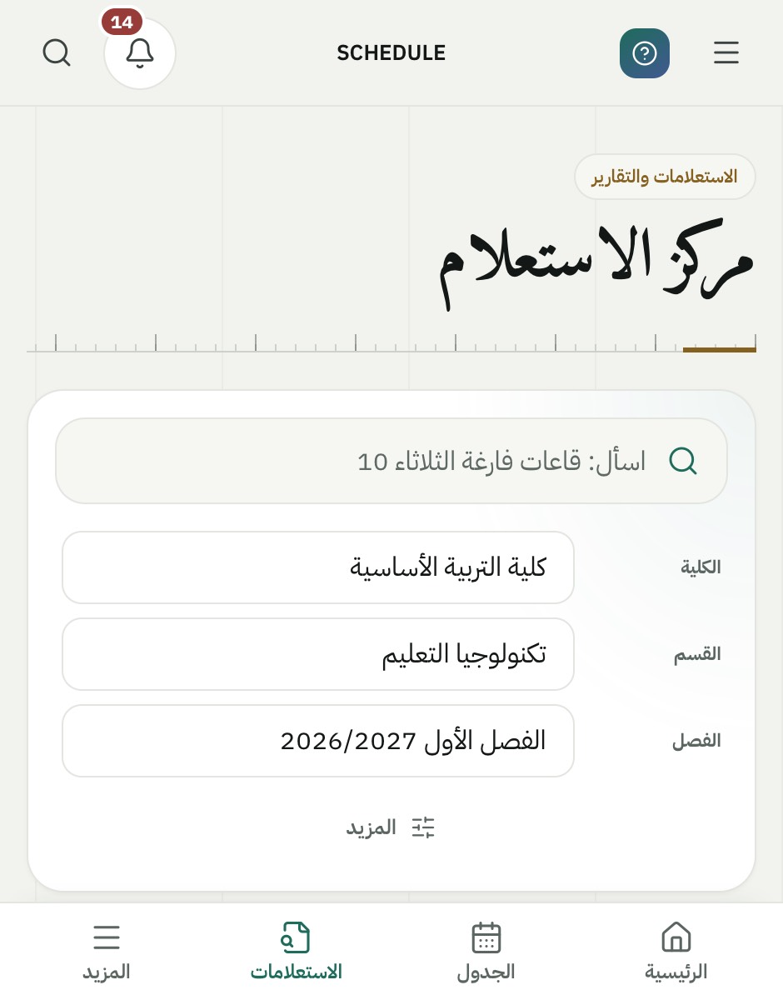 | 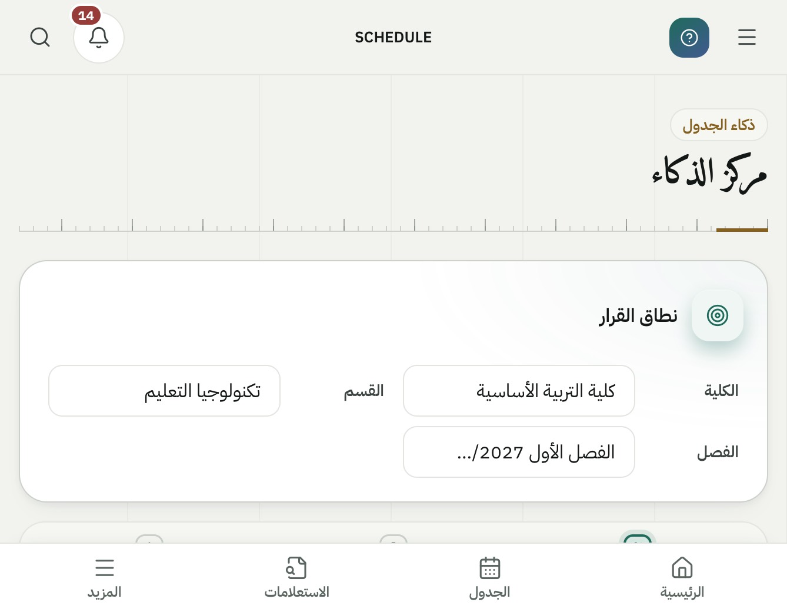 |
| J بعد الانتقال الحي إلى 382×580 | | 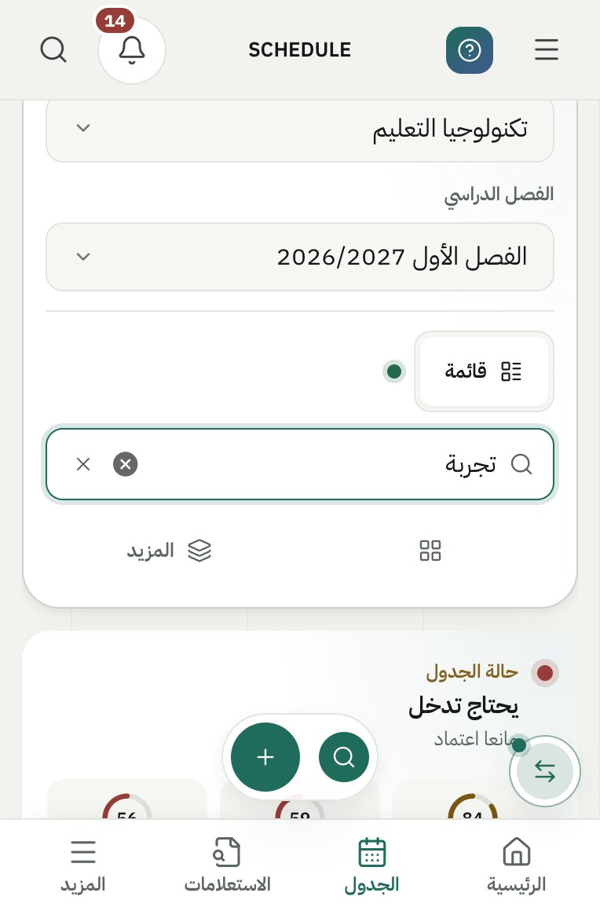 |

## 6. ما يجب فحصه على جهاز حقيقي

1. القرص بإصبعين يكبّر الصفحة في الجدول والتقارير، والتمرير بإصبع واحد في الجدول الكثيف يعمل كما كان.
2. الدوو مطوياً أفقياً: الجرس داخل الشريط العلوي النحيف، وأزرار الشريط السفلي تُضغط بسهولة.
3. الآيفون أفقياً: أول عمود من المحتوى لا يقع تحت الفتحة، والخلفية تمتد إلى الحافة.
4. ورقة تقرير PDF وورقة الاجتماع على الهاتف: زرّ أسفل الورقة ظاهر فوق شريط Safari.
5. وضعا الكتاب والطاولة حين يُفعَّل الـ API.
