# iPhone Duo — قبول الجولة الأخيرة: الشاشة الداخلية كتابٌ مفتوح (14 نوفمبر 2026)

تبني هذه الجولة على `docs/IPHONE-DUO-ADAPTIVE-QUALITY.md` (جولة 13 نوفمبر). النطاق طبقة العرض وحدها: CSS، وسطرٌ في `public/schedule-presentation.html` (سجلّ العرض)، واختبارات، وأداة قياس، ووثائق. لم يُمَسّ محرّك التعارض ولا أوقات المحاضرات ولا بيانات الطلبة ولا الصلاحيات ولا Firestore ولا تصدير PDF ولا الخادم ولا ملفات النشر، ولم يُعَد بناء `Schedules.tsx` ولم يُغيَّر فيه سطر.

رموز الحالة: `PASS` مقيسٌ وسليم، `PARTIAL` يعمل وبقي فيه أثرٌ مقيس (نصٌّ ضيّق أو عنصرٌ مقصوص قليلاً)، `FAIL` خللٌ باقٍ، `BLOCKED` لم يُبلَغ (والسبب مكتوب)، `NOT_TESTED` لم يُختبر.

لم يُختبر شيءٌ على جهاز iPhone Duo حقيقي. كل ما هنا محاكاةٌ في Playwright WebKit على بناءٍ إنتاجي محلي بالوضع التجريبي.

## 1. ما كان (قبل)

- **الشاشة الداخلية عمودٌ ممدود.** على 669×867 و951×585 كان التطبيق صفحةَ هاتفٍ أو حاسوبٍ ممدودة، وكل سطرٍ تقريباً يعبر منتصف الشاشة حيث المفصل. القياس على `origin/main`: في **63 من 63** مشهداً داخلياً (21 شاشة × 669×867 و669×520 و951×585) نصٌّ أو زرٌّ يقطع منطقة الكعب، وشاشة الدخول كذلك (9 و10 عناصر).
- **النوافذ تعبر الكعب.** البحث الشامل (11–12 عنصراً على الكعب)، ونموذج «موعد جديد» عمودان محشوران في نصف الشاشة.
- **خلل P0 من تسجيل الجهاز الحقيقي:** في «مركز الاستعلام» على لسان **«القاعات × الأوقات»** تتسع الوثيقة كلها: `scrollWidth − clientWidth` = **+414px على 669×867** و**+146px على 951×585** (مقيس على `origin/main`)، فيصغّر iOS الصفحة، ويهرب الجرس والبحث إلى الحافة، ويظهر هامشٌ فارغ يميناً.
- **الطاولة 951×350:** شريطٌ علوي ثابت ولا شريط تحكّم في الأسفل.

## 2. ما تغيّر

| # | التغيير | أين |
|---|---|---|
| 1 | **الكتاب المفتوح.** في `screen and (min-width:640px) and (max-width:1000px) and (min-height:520px) and (max-height:960px)` (أي 669×867 و669×520 و951×585، وليس iPad 768×1024 ولا 1024×768) صار التطبيق صفحتين حول كعبٍ عرضه 32px في المنتصف: خيطٌ رفيع وظلُّ طيٍّ خفيف، لا يأخذ لمسة. الخلفية ممتدة من حافة لحافة | `src/styles/55-duo-adaptive.css` |
| 2 | **الصفحة اليمنى فهرس:** القائمة نفسها (الدُّرج على الهاتف) ثابتةٌ كصفحة بلون الورق، فوقها البحث الشامل والجرس والمرشد، وتُمرَّر كلها كصفحة. اختيرت اليمنى لأنها مكان القائمة على الحاسوب وفي تخطيط المفصل الحقيقي `47-duo-open-workspace.css` الذي يحرسه `tests/mobile-overflow-css-audit.ts`، فلا تقفز القائمة بين الوضعيتين | نفسه |
| 3 | **الصفحة اليسرى عمل:** الجدول والتقارير والسجلات والنماذج. ولأن عرضها 286–430px، تأخذ ترتيب الهاتف نفسه: كل استعلام `@media (max-width:600–900px)` في أوراق الأنماط صار قائمةً تضيف كتلة الكتاب (`…,screen and (min-width:640px) and … (max-height:960px)`)، فتحصل صفحة العمل على ترتيب الهاتف المختبَر بدل ترتيب الحاسوب محشوراً. استُثني `max-width:639px` (ما يُقصد به «أصغر من الدوو المفتوح»). لا تغيير خارج هذا المقاس | 47 ملف CSS (سطر الاستعلام وحده) |
| 4 | **«موعد جديد / تعديل موعد» صفحتان:** الأسئلة على اليمنى، و«أسبوع الأستاذ» على اليسرى بمحاذاتها، والفهرس يتنحّى ما دام النموذج مفتوحاً، و«✕» هو الخروج | `55-duo-adaptive.css` |
| 5 | **النوافذ والأدراج على صفحة العمل:** كل خلفيةٍ تحمل نافذةً (`[class*=backdrop]`/`[class*=scrim]` مع `role=dialog`) تُحصر في الصفحة اليسرى ويُعتَّم الفهرس بظلّها؛ ودرج تفاصيل الموعد ودرج مركز الذكاء ونموذج السجلات والأثر يأخذون الصفحة اليسرى كاملة. الرسائل العابرة وتنبيه الجلسة وشريط التراجع وأدوات الجدول العائمة في وسط صفحة العمل | نفسه |
| 6 | **الدخول كتاباً:** القصة والعلامة على اليمنى، وبطاقة الدخول على اليسرى، والكعب فارغ | `src/styles/49-duo-login.css` |
| 7 | **الطاولة (ارتفاع ≤480):** الشريط العلوي يمضي مع التمرير (المحتوى يأخذ الشاشة)، وشريط التنقل ثابتٌ في الأسفل حتى بين 769 و1119 (كان للهاتف وحده)، والصفحة تحجز ارتفاعه، وفقاعة وارد القاعات فوقه لا عليه | `55-duo-adaptive.css` |
| 8 | **إصلاح P0 «القاعات × الأوقات» من جذره:** خلايا الشبكة تحمل `.sr-only` (`position:absolute`)، وإطار التمرير `.matrix-scroll` لم يكن كتلةً حاوية، فتُحسب تلك العناصر من الصفحة نفسها، وتبرز خارج قصّ الإطار وتوسّع الوثيقة. صار `.matrix-scroll` وأخواته من أطر التمرير الأفقي (`.table-scroll`، `.data-table-wrap`، `.report-table-wrap`، `.rooms-scroll`، `.occupancy-scroll`، `.timeline-scroll`، `.comparison-scroll`) `position:relative`. الشبكة تُمرَّر داخل بطاقتها، والعمود الثابت (sticky) كما كان. بعد: **0** على 669 و951 و382 في كل لسان | `src/styles/06-intelligence.css` |
| 9 | إصلاحاتٌ موضعية لصفحة العمل الضيّقة: نطاق مركز الذكاء ومرشّحات مركز الاستعلام (التسمية فوق الحقل بدل قوائم مقطوعة)، بطاقة مواعيد التسليم، صحيفة التخرج المرجعية، مبدّل عرض الجدول | `55-duo-adaptive.css`، `12-deadlines.css` |

`!important` الجديدة محصورة: ثلاثٌ تقابل `!important` قائمة (`html[data-rail=open] .schedule-dock` في `07-responsive.css`، وقواعد الدخول للمقاسات نفسها في `49-duo-login.css`)، وإخفاء الشريطين في الكتاب. لا ملف «تجميل» جديد.

الحالة لا تُفقد: لا شيء يُعاد تركيبه عند تغيّر المقاس؛ كل ما سبق CSS خالص. الانتقال الحي (القسم 5) يثبت ذلك.

## 3. جرد الشاشات

من `pathByView` في `src/App.tsx` (40 وجهة) ومن مسارات الدخول، ومن الألسنة والنوافذ في المكوّنات. كلٌّ له سطرٌ في المصفوفة:

- **الدخول** (`/` بلا جلسة).
- **40 وجهة في القائمة** + الرابط القديم `/System/Locations` + مسارٌ مجهول (يعرض الرئيسية؛ لا شاشة 404 مستقلة).
- **الألسنة:** كل `[role=tab]` ظاهر في 12 شاشة (مركز الاستعلام بلسانه الـ14، تقرير القسم، مركز الذكاء، التغييرات، كشف التسجيل، آلة الزمن، إعداد القاعات، الوارد، والبحوث الأربعة) — القسم 4.3.
- **النوافذ والأدراج والنماذج:** موعد جديد، تفاصيل موعد، أدوات البيانات، النشر، البحث الشامل، الإشعارات، فريقي، الأثر، درج القاعة في مركز الذكاء، نماذج الفصول والأقسام والأساتذة والمقررات، ألسنة التغييرات، طلبٌ في الوارد، وألسنة مركز الاستعلام — القسم 4.2.
- **حالات فارغ/تحميل/خطأ:** تظهر داخل الشاشات أعلاه بحسب البيانات التجريبية (مثلاً «لا محاضرات اليوم» في الرئيسية، و«هنا يظهر أسبوع الأستاذ» في النموذج)؛ حالة «انقطاع الاتصال» (`connectionGate`) لم تُستحث: **NOT_TESTED**.
- **صفحات خارج التطبيق:** `/me` و`/me/demo` (مساري للطالب) وصفحات طلب الأستاذ التي يولّدها الخادم: **NOT_TESTED** في هذه الجولة (لها تخطيطها المستقل ولم تُمَسّ).

## 4. المصفوفة

الوضعيات: **A** مطوي طولي (382×580، 385×571، 320×568) · **B** مطوي عرضي (594×368) · **C** كتابٌ طولي (669×867) · **D** كتابٌ عرضي (951×585) · **E** طاولة (951×350، 600×350) · **F** داخلي قصير (669×520، 600×480) · **G** لوحي/حاسوب (768×1024، 1024×768، 1280×800، 1440×900) · **H** هاتف مرجعي (360×640، 390×844، 844×390) · **I** انتقال حي · **J** إجهاد الإتاحة.

القياس لكل مشهد (`docs/iphone-duo-final/duo-book-audit.mjs`): تمرير أفقي للوثيقة، نصٌّ أو عنصر تحكّم يقطع الكعب (في الكتاب)، عنوانٌ/زرٌّ/حقلٌ مقصوص أو خارج الشاشة، عمودٌ يكسر النص كلمةً في كل سطر، وأهداف لمس أصغر من 44px (عدداً).

### 4.1 الشاشات × A–H

| الشاشة | المسار | A | B | C | D | E | F | G | H |
|---|---|---|---|---|---|---|---|---|---|
| الدخول (بلا جلسة) | `/ (الدخول)` | PASS | PASS | PASS | PASS | PASS | PASS | PASS | PASS |
| لوحة التحكم | `/Home/Index` | PASS | PASS | PASS | PASS | PASS | PASS | PASS | PASS |
| الجدول الدراسي | `/FSchedule/Index` | PASS | PASS | PASS | PASS | PASS | PASS | PARTIAL | PARTIAL |
| جدول القسم | `/FSchedule/DepartmentSchedule` | PASS | PASS | PASS | PASS | PASS | PASS | PASS | PASS |
| نسخ الجدول | `/FSchedule/CopySchedule` | PASS | PASS | PASS | PASS | PASS | PASS | PASS | PASS |
| مركز الذكاء | `/Schedule/Intelligence` | PASS | PASS | PASS | PASS | PASS | PASS | PASS | PASS |
| آلة الزمن | `/FSchedule/TimeMachine` | PASS | PASS | PASS | PASS | PASS | PASS | PASS | PASS |
| تغييرات الجدول | `/FSchedule/Changes` | PASS | PASS | PASS | PASS | PASS | PASS | PASS | PASS |
| رغبات الأساتذة (الوارد) | `/FSchedule/InstructorRequests` | PASS | PASS | PASS | PASS | PASS | PASS | PASS | PASS |
| ورقة التسجيل | `/FSchedule/StudentRegistration` | PARTIAL | PASS | PARTIAL | PASS | PASS | PARTIAL | PASS | PASS |
| مراجعة الصحيفة | `/FSchedule/PlanReview` | PASS | PASS | PASS | PASS | PARTIAL | PASS | PARTIAL | PASS |
| محاكي الشعب | `/FSchedule/Rehearsal` | PASS | PASS | PASS | PASS | PASS | PASS | PARTIAL | PARTIAL |
| بحث أستاذ | `/FSchedule/InstructorReport` | PASS | PASS | PASS | PASS | PASS | PASS | PASS | PASS |
| بحث قاعة | `/FSchedule/RoomReport` | PASS | PASS | PASS | PASS | PASS | PASS | PASS | PASS |
| بحث وقت | `/FSchedule/TimeReport` | PASS | PASS | PASS | PASS | PASS | PASS | PASS | PASS |
| بحث قاعة ووقت | `/FSchedule/RoomTimeReport` | PASS | PASS | PASS | PASS | PASS | PASS | PASS | PASS |
| مركز الاستعلام | `/FSchedule/MainReport` | PASS | PASS | PASS | PASS | PASS | PASS | PASS | PASS |
| تقرير القسم | `/FSchedule/MainScheduleReport` | PASS | PASS | PASS | PASS | PASS | PASS | PASS | PASS |
| تقرير أستاذ | `/FSchedule/InstructorReportRPT` | PASS | PASS | PASS | PASS | PASS | PASS | PASS | PASS |
| تقرير قاعة | `/FSchedule/RoomReportRPT` | PASS | PASS | PASS | PASS | PASS | PASS | PASS | PASS |
| تقرير وقت | `/FSchedule/TimeReportRPT` | PASS | PASS | PASS | PASS | PASS | PASS | PASS | PASS |
| تقرير قاعة ووقت | `/FSchedule/RoomTimeReportRPT` | PASS | PASS | PASS | PASS | PASS | PASS | PASS | PASS |
| الفصول | `/AdTerm/Index` | PASS | PASS | PASS | PASS | PASS | PASS | PASS | PASS |
| الكليات | `/AdCollege/Index` | PASS | PASS | PASS | PASS | PASS | PASS | PASS | PASS |
| الأقسام | `/AdSection/Index` | PASS | PASS | PASS | PASS | PASS | PASS | PASS | PASS |
| الأساتذة | `/AdInstructor/Index` | PASS | PASS | PASS | PASS | PASS | PASS | PASS | PASS |
| المقررات | `/AdCourse/Index` | PARTIAL | PASS | PARTIAL | PASS | PASS | PARTIAL | PASS | PASS |
| المستخدمون | `/SystemUser/Index` | PASS | PASS | PASS | PASS | PASS | PASS | PASS | PASS |
| المقاعد والرتب | `/SystemUser/Seats` | PARTIAL | PARTIAL | PASS | PARTIAL | PARTIAL | PARTIAL | PASS | PARTIAL |
| الصلاحيات | `/FormSecurity/Index` | PASS | PASS | PASS | PASS | PASS | PASS | PASS | PASS |
| النطاقات | `/AdCollegeUserAssign/Index` | PASS | PASS | PASS | PASS | PASS | PASS | PASS | PASS |
| سجل التدقيق | `/System/AuditLog` | PASS | PASS | PASS | PASS | PASS | PASS | PASS | PASS |
| المباني والقاعات (الرابط القديم) | `/System/Locations` | PASS | PASS | PASS | PASS | PASS | PASS | PASS | PASS |
| إعداد القاعات | `/System/LocationSetup` | PASS | PASS | PASS | PASS | PASS | PASS | PASS | PASS |
| ساعات الأقسام | `/System/SectionHours` | PARTIAL | PASS | PARTIAL | PASS | PASS | PARTIAL | PASS | PASS |
| النصاب التدريسي | `/System/TeachingLoad` | PASS | PASS | PASS | PASS | PASS | PASS | PASS | PASS |
| النسخ الاحتياطي | `/System/Backup` | PASS | PASS | PASS | PASS | PASS | PASS | PASS | PASS |
| الجمهور | `/System/Audience` | PASS | PASS | PASS | PASS | PASS | PASS | PASS | PASS |
| الإعلانات | `/System/Ads` | PASS | PASS | PASS | PASS | PASS | PASS | PASS | PASS |
| عن النظام | `/Public/Aboutus` | PASS | PASS | PASS | PASS | PASS | PASS | PASS | PASS |
| مسار مجهول (يعرض الرئيسية) | `/no-such-page` | PASS | PASS | PASS | PASS | PASS | PASS | PASS | PASS |

المجموع: PASS 307، PARTIAL 21 (328 خانة = 41 شاشة × 8 وضعيات، وكل خانةٍ هي أسوأ مقاسٍ فيها؛ 708 مشهداً مقيساً، و54 في Split View). لا `FAIL` ولا `BLOCKED`.

تفصيل كل ما ليس `PASS` (لا شيء منه يعبر الكعب أو يوسّع الوثيقة):

- G 768x1024 الجدول الدراسي: مقصوص: button.icon-action.icon-action-week«الجدول الدراسي» [11…53 / مرئي 37]؛ button.icon-action.icon-action-week«الجدول الدراسي» [11…53 / مرئي 37]
- H 844x390 الجدول الدراسي: مقصوص: button.icon-action.icon-action-edit«تعديل» [4…46 / مرئي 20]؛ button.icon-action.icon-action-edit«تعديل» [4…46 / مرئي 20]
- A 320x568 ورقة التسجيل: نص ضيّق: strong«خالد (طالب تجريبي)»
- C 669x867 ورقة التسجيل: نص ضيّق: strong«خالد (طالب تجريبي)»
- F 669x520 ورقة التسجيل: نص ضيّق: ?
- E 951x350 مراجعة الصحيفة: نص ضيّق: ?
- G 1280x800 مراجعة الصحيفة: نص ضيّق: ?
- G 1280x800 محاكي الشعب: نص ضيّق: ?
- H 844x390 محاكي الشعب: نص ضيّق: h1«رادار يوم التسجيل»
- A 320x568 المقررات: نص ضيّق: span«أخلاقيات استخدام التكن»
- C 669x867 المقررات: نص ضيّق: span«أخلاقيات استخدام التكن»
- F 669x520 المقررات: نص ضيّق: ?
- A 382x580 المقاعد والرتب: نص ضيّق: span«بلا رئيس مسجّل»
- A 385x571 المقاعد والرتب: نص ضيّق: span«بلا رئيس مسجّل»
- B 594x368 المقاعد والرتب: نص ضيّق: span«بلا رئيس مسجّل»
- D 951x585 المقاعد والرتب: نص ضيّق: span«بلا رئيس مسجّل»
- E 600x350 المقاعد والرتب: نص ضيّق: ?
- F 600x480 المقاعد والرتب: نص ضيّق: ?
- H 390x844 المقاعد والرتب: نص ضيّق: span«بلا رئيس مسجّل»
- A 320x568 ساعات الأقسام: نص ضيّق: span«التصميم التعليمي (تجري»
- C 669x867 ساعات الأقسام: نص ضيّق: span«التصميم التعليمي (تجري»
- F 669x520 ساعات الأقسام: نص ضيّق: ?

`?` = مشهدٌ قيس من سجلّ التشغيل لا من JSON (توقّف خادم القياس في آخر دفعة E–G فأُخذت الأعداد من السجلّ نفسه).

أهداف لمسٍ أصغر من 44px (مجموع العناصر في كل المشاهد، معلومةٌ لا معيار قبول في هذه الجولة): {'A': 267, 'B': 89, 'C': 171, 'D': 295, 'E': 311, 'F': 262, 'G': 1130, 'H': 441, 'S': 0}
. أغلبها خلايا شبكة الأسبوع الكثيفة على الحاسوب (G) ورقائق صغيرة قائمة قبل هذه الجولة؛ لم تُغيَّر.

### 4.2 النوافذ والأدراج

| النافذة / الدرج | 382x580 | 594x368 | 669x867 | 951x585 | 951x350 | 600x350 |
|---|---|---|---|---|---|---|
| الجدول › موعد جديد | PASS¹ | PASS¹ | PASS¹ | PASS¹ | PASS¹ | PASS¹ |
| الجدول › تفاصيل موعد | PASS | PASS | PARTIAL | PASS | PASS | PASS |
| البحث الشامل | PASS | PASS | PASS | PASS | PASS | PASS |
| الإشعارات | BLOCKED | BLOCKED | BLOCKED | BLOCKED | BLOCKED | BLOCKED |
| الأثر | PASS | PASS | PASS | PASS | PASS | PASS |
| مركز الذكاء › درج القاعة | PASS | PASS | PASS | PASS | PASS | PASS |
| الفصول › نموذج | PASS | PASS | PASS | PASS | PASS | PASS |
| الأقسام › نموذج | PASS | PASS | PASS | PASS | PASS | PASS |
| الأساتذة › نموذج | PASS | PASS | PASS | PASS | PASS | PASS |
| المقررات › نموذج | PASS | PASS | PARTIAL | PASS | PASS | PASS |
| صندوق الطلبات › طلب | PASS¹ | PASS¹ | PASS¹ | PASS¹ | PASS¹ | PASS¹ |
| مركز الاستعلام › الأسبوع | PASS | PASS | PASS¹ | PASS¹ | PASS | PASS |
| مركز الاستعلام › الأساتذة | PASS¹ | PASS¹ | PASS¹ | PASS¹ | PASS¹ | PASS¹ |
| مركز الاستعلام › المزيد | PASS¹ | PASS¹ | PASS¹ | PASS¹ | PASS¹ | PASS¹ |
| الجدول › أدوات البيانات | PASS | PASS | PASS | PASS | PASS | PASS |
| الجدول › النشر | PASS | PASS | PASS | PASS | PASS | PASS |
| فريقي | BLOCKED | BLOCKED | BLOCKED | BLOCKED | BLOCKED | BLOCKED |
| التغييرات › تعديل المواعيد | PASS¹ | PASS¹ | PASS¹ | PASS¹ | PASS¹ | PASS¹ |
| التغييرات › تغيير موعد التسليم | PASS¹ | PASS¹ | PASS¹ | PASS¹ | PASS¹ | PASS¹ |

¹ ضُغط الزر ولم تُفتح نافذة (تعديلٌ في الصفحة نفسها أو لا طلب في الحالة التجريبية)؛ قيست الصفحة كما هي.

- **الإشعارات: BLOCKED** — الضغط على الجرس يُسقط WebKit في Playwright (طلب إذن الإشعارات في وضع الأتمتة)، فلا قياس. لوحة الإشعارات مقيّدة بالكتاب في `55-duo-adaptive.css` (على صفحة الفهرس تحت الجرس، بعرض الصفحة) بمراجعة الكود فقط.
- **فريقي: BLOCKED** — لا زرّ «فريقي» ظاهر لصفة المدير التجريبية في هذه المقاسات.
- النشر بخطواته، وأدوات البيانات، والبحث الشامل، وتفاصيل الموعد، ونماذج السجلات، والأثر، ودرج القاعة: تُفتح كلها على صفحة العمل اليسرى، والفهرس معتمٌ خلفها، و0 عنصر على الكعب.

### 4.3 الألسنة (انحدار «القاعات × الأوقات»)

كل لسانٍ يُنقر ثم تُقاس الوثيقة.

| الشاشة | 669×867 | 951×585 | 382×580 |
|---|---|---|---|
| مركز الاستعلام | 14 لسان، توسّع 0 | 14 لسان، توسّع 0 | 14 لسان، توسّع 0 |
| تقرير القسم | 14 لسان، توسّع 0 | 14 لسان، توسّع 0 | 14 لسان، توسّع 0 |
| بحث أستاذ | 14 لسان، توسّع 0 | 14 لسان، توسّع 0 | 14 لسان، توسّع 0 |
| بحث قاعة | 14 لسان، توسّع 0 | 14 لسان، توسّع 0 | 14 لسان، توسّع 0 |
| بحث وقت | 14 لسان، توسّع 0 | 14 لسان، توسّع 0 | 14 لسان، توسّع 0 |
| بحث قاعة ووقت | 14 لسان، توسّع 0 | 14 لسان، توسّع 0 | 14 لسان، توسّع 0 |

المجموع: **252** نقرة لسان، **0** توسّع للوثيقة (كان «القاعات × الأوقات» +414/+146 قبل الإصلاح). شاشات أخرى ذات ألسنة (مركز الذكاء، التغييرات، كشف التسجيل، آلة الزمن، إعداد القاعات، الوارد) لا تستعمل `role=tab` داخل `main`، فقيست صفحاتها ونوافذها في 4.1 و4.2 لا لسانٍ لسان: **PARTIAL (تغطية)**.

الاختبار الثابت `tests/mobile-overflow-css-audit.ts` يحرس الإصلاح (إطار التمرير كتلةٌ حاوية)، وأداة القياس `duo-book-audit.mjs tabs` تحرسه حياً وتخرج بغير صفر إن اتّسعت الوثيقة.

### 4.4 Split View (عرض 320 / 470 / 620 × ارتفاع 350 / 600 / 900)

| المقاس | الحالة | تمرير أفقي | مقصوص | لمس <44 |
|---|---|---|---|---|
| 320x350 | PARTIAL | 0 | 0 | 31 |
| 320x600 | PARTIAL | 0 | 0 | 31 |
| 320x900 | PARTIAL | 0 | 0 | 31 |
| 470x350 | PASS | 0 | 0 | 31 |
| 470x600 | PASS | 0 | 0 | 31 |
| 470x900 | PASS | 0 | 0 | 31 |
| 620x350 | PASS | 0 | 0 | 31 |
| 620x600 | PASS | 0 | 0 | 33 |
| 620x900 | PASS | 0 | 0 | 33 |

الشاشات: الرئيسية، الجدول، مركز الاستعلام، المقررات، مركز الذكاء، التغييرات. `PARTIAL` في 320 = نصٌّ ضيّق في بطاقة مقرر طويل الاسم (قائم قبل الجولة).

## 5. I — الانتقال الحي

صفحةٌ واحدة بلا إعادة تحميل (مركز الاستعلام): 951×585 ← 669×867 ← 470×700 ← 382×580 ← 594×368 ← 951×350 ← 951×585.

| الخطوة | المقاس | كتاب؟ | النص المكتوب باقٍ | التمرير (scrollY) | الصفحة نفسها (بلا تحميل) | تمرير أفقي | يعبر الكعب |
|---|---|---|---|---|---|---|---|
| 1 | 951x585 | نعم | نعم | 194 | نعم | 0 | 0 |
| 2 | 669x867 | نعم | نعم | 194 | نعم | 0 | 0 |
| 3 | 470x700 | لا | نعم | 194 | نعم | 0 | 0 |
| 4 | 382x580 | لا | نعم | 194 | نعم | 0 | 0 |
| 5 | 594x368 | لا | نعم | 194 | نعم | 0 | 0 |
| 6 | 951x350 | لا | نعم | 194 | نعم | 0 | 0 |
| 7 | 951x585 | نعم | نعم | 194 | نعم | 0 | 0 |

نافذة «البحث الشامل» مفتوحةٌ ثم يُغيَّر المقاس: 669x867: مفتوحة (كعب 0)، 382x580: مفتوحة (كعب 0)، 951x350: مفتوحة (كعب 0)، 951x585: مفتوحة (كعب 0).

**I: PASS.**

## 6. J — إجهاد الإتاحة

| الحالة | المقاس | الشاشات | تمرير أفقي | يعبر الكعب | مقصوص | نص ضيّق | الحقل المركَّز |
|---|---|---|---|---|---|---|---|
| نص 200% | 669x867 | 4 | 0 | 0 | 0 | 1 | — |
| نص 200% | 951x585 | 4 | 0 | 0 | 0 | 0 | — |
| نص 200% | 382x580 | 4 | 0 | 0 | 0 | 0 | — |
| الوضع الداكن | 669x867 | 4 | 0 | 0 | 0 | 1 | — |
| الوضع الداكن | 951x585 | 4 | 0 | 0 | 0 | 0 | — |
| لوحة مفاتيح (محاكاة) | 951x585 | 4 | 0 | 0 | 0 | 0 | in-view, none, off-view |
| لوحة مفاتيح (محاكاة) | 669x867 | 4 | 0 | 0 | 0 | 0 | in-view, none, off-view |
| حواف أمان غير متناظرة (محاكاة) | 951x585 | 4 | 0 | 0 | 0 | 0 | — |

الشاشات في كل حالة: الرئيسية، الجدول، مركز الاستعلام، المقررات. «النص الضيّق» الوحيد: اسم مقرر طويل في بطاقة المقررات على 669. لوحة المفاتيح: الحقل المركَّز خرج من الإطار في بعض الشاشات حين قُصّ الارتفاع فجأة؛ على iOS تُمرِّر Safari الحقل إلى الظاهر ولا يتغيّر الـ layout viewport، فهذه محاكاةٌ قاسية. **J: PARTIAL (محاكاة)**.

- **حواف الأمان غير المتناظرة:** WebKit في Playwright يعيد `env(safe-area-inset-*)` صفراً، فحُقنت حشوةٌ تحاكيها (47px يساراً على صفحة العمل، 20px يميناً على الفهرس). الأرقام الحقيقية على الجهاز: **NOT_TESTED**.
- **لوحة المفاتيح:** محاكاة بتصغير الارتفاع إلى 350/360 مع حقلٍ مركَّز؛ لوحة مفاتيح iOS الحقيقية لا تغيّر الـ layout viewport أصلاً. **PARTIAL (محاكاة)**.
- **المفصل الحقيقي (`viewport-segments`):** لا يُحاكى في WebKit؛ كتلة `47-duo-open-workspace.css` باقية وتتفق مع الكتاب (القائمة يميناً والعمل يساراً). **NOT_TESTED**.

## 7. صور قبل/بعد

| الحالة | قبل (`origin/main`) | بعد |
|---|---|---|
| C 669×867 الرئيسية | 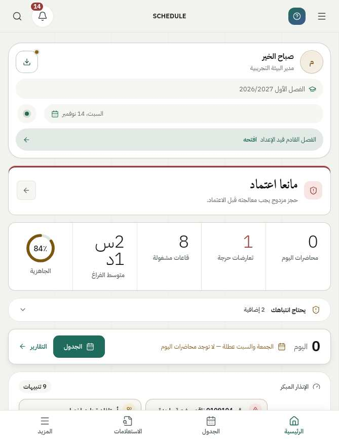 | 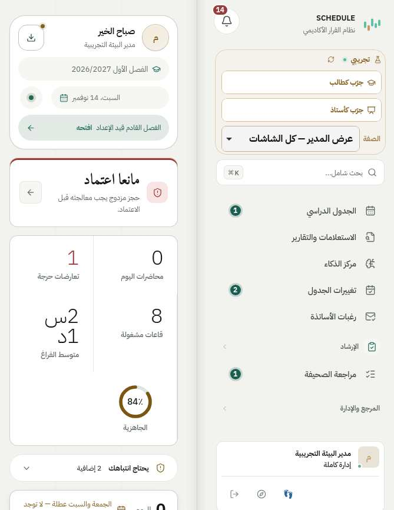 |
| C 669×867 الجدول | 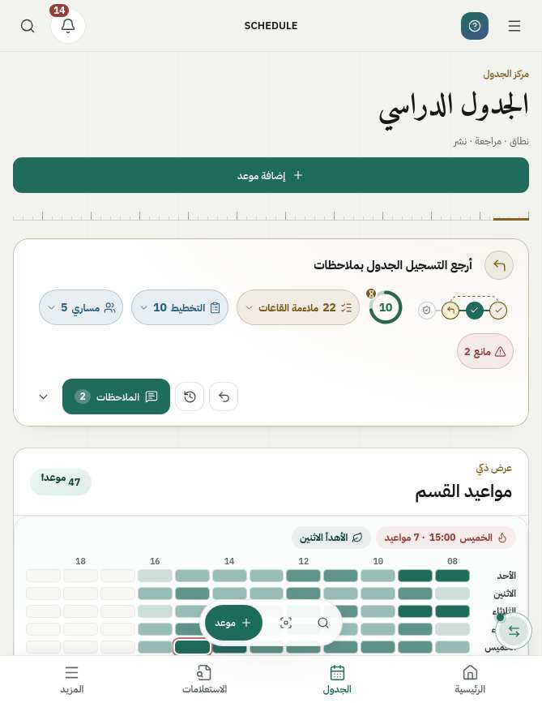 | 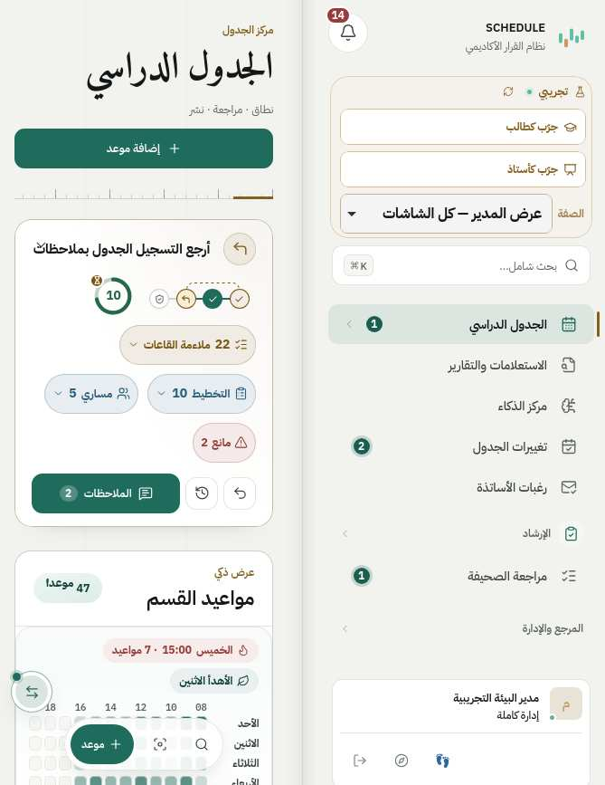 |
| C 669×867 «القاعات × الأوقات» (خلل P0) | 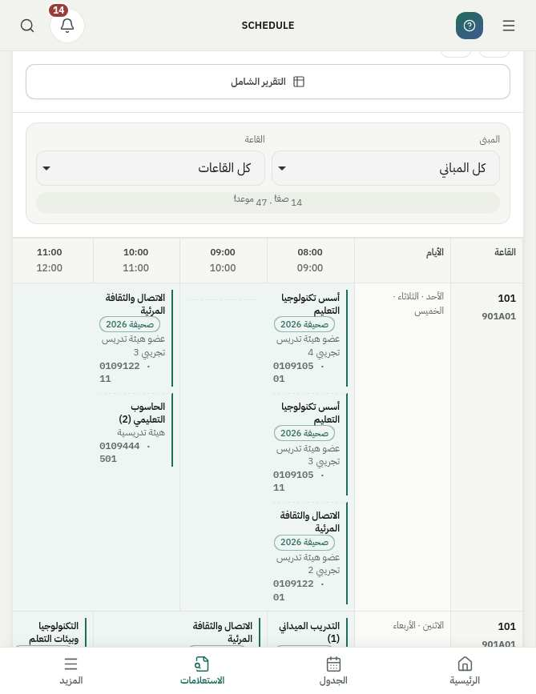 | 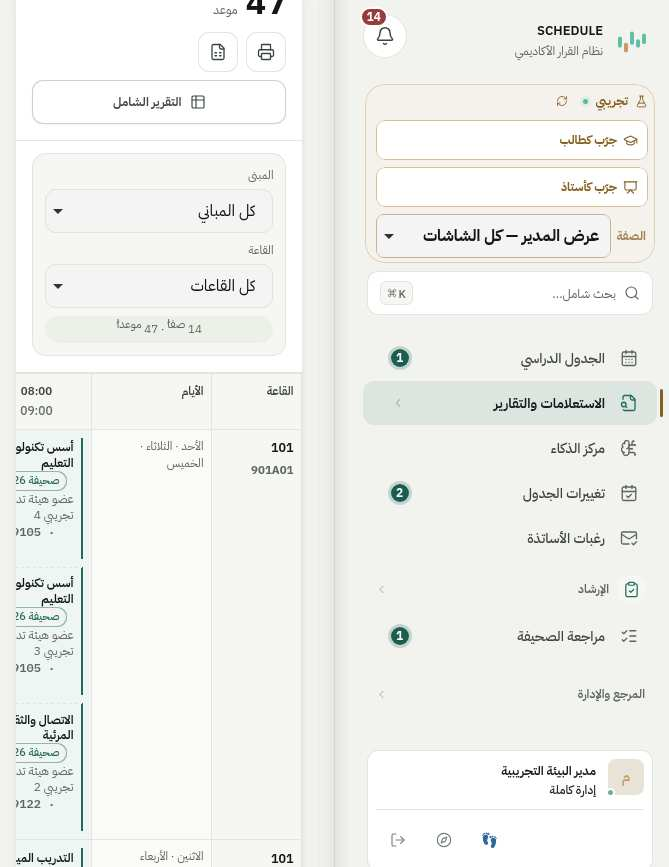 |
| C 669×867 الدخول | 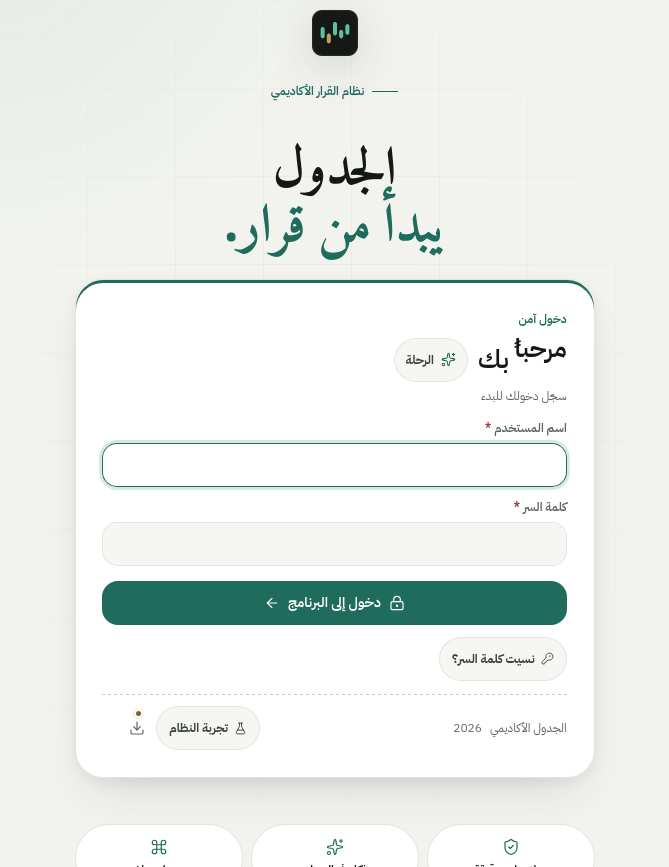 | 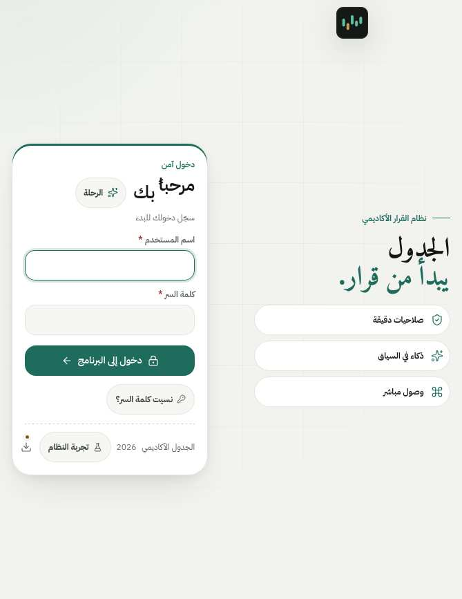 |
| D 951×585 الرئيسية | 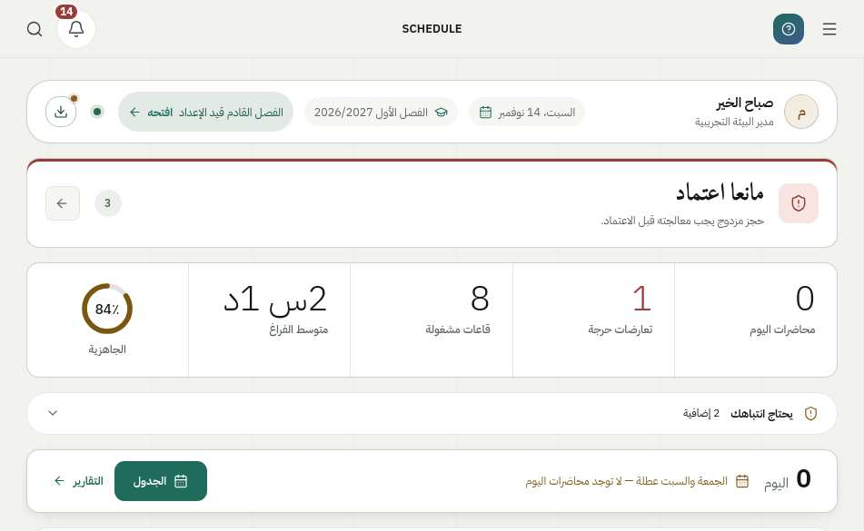 | 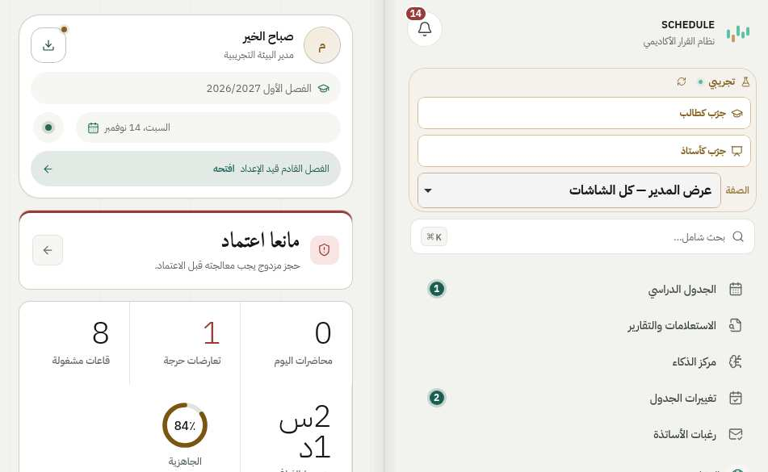 |
| D 951×585 الجدول | 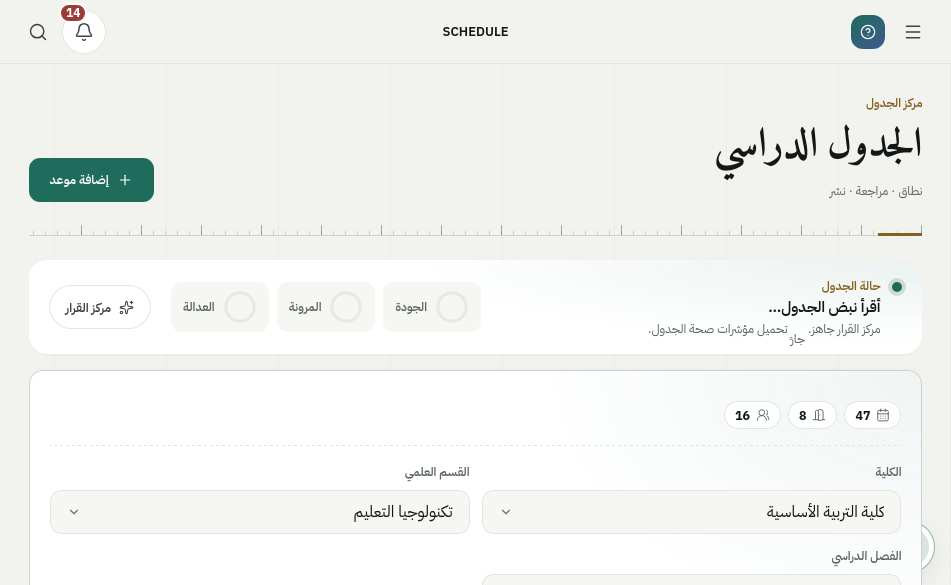 | 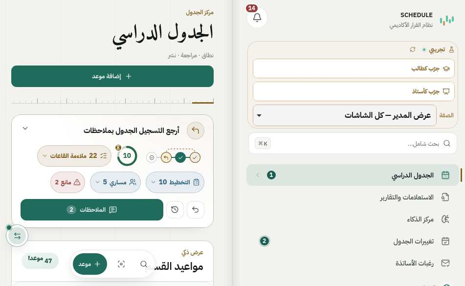 |
| D 951×585 مركز الاستعلام | 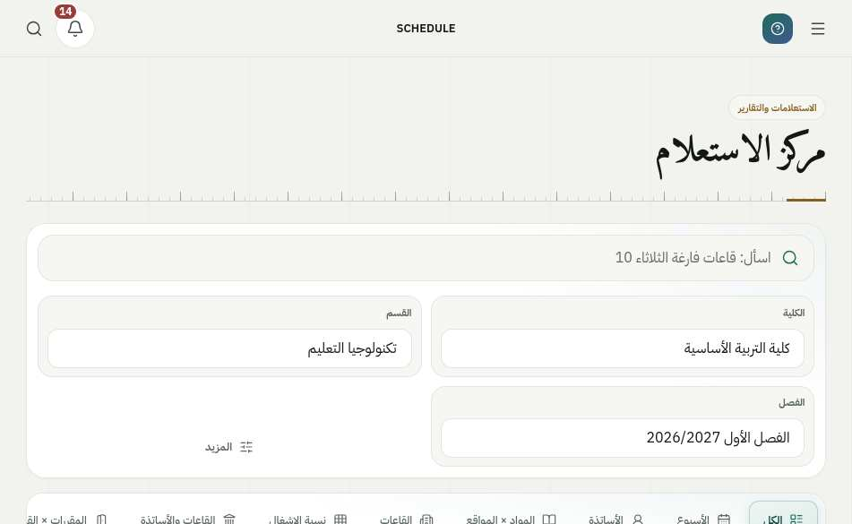 | 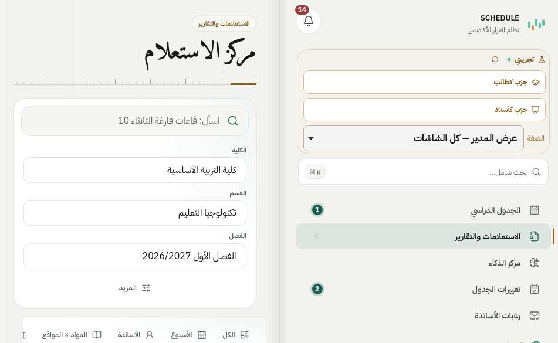 |
| D 951×585 الدخول | 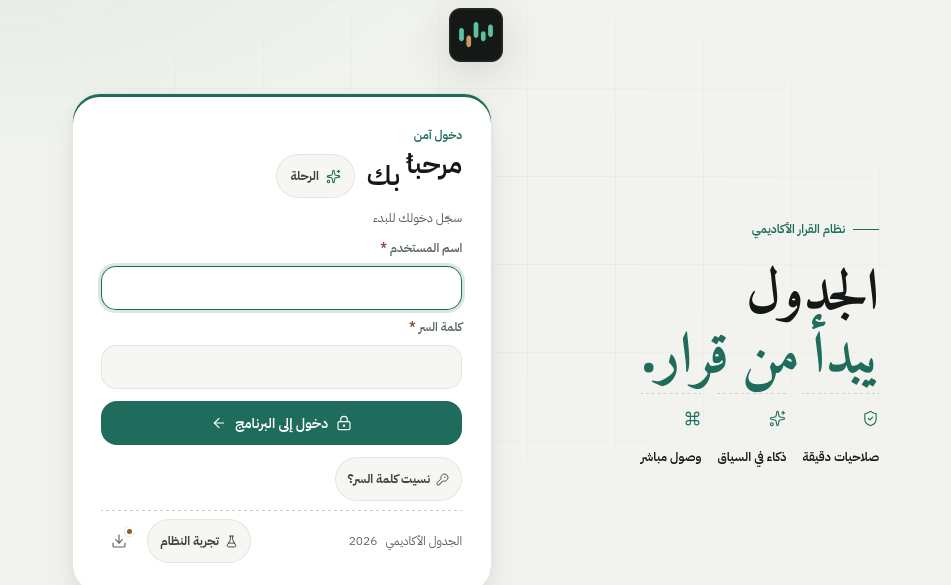 | 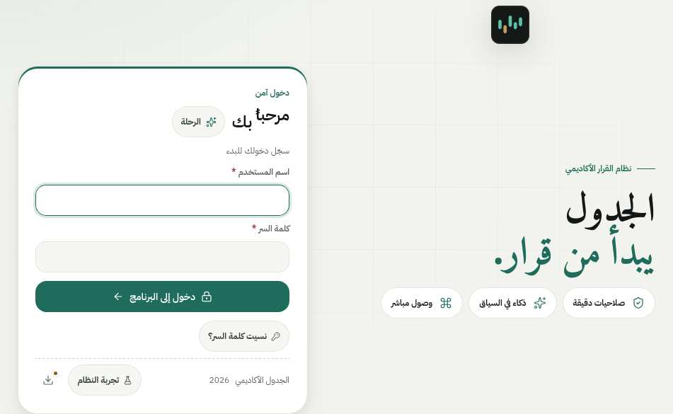 |
| A 382×580 و B 594×368 الجدول (بعد) | — | 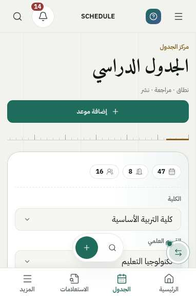 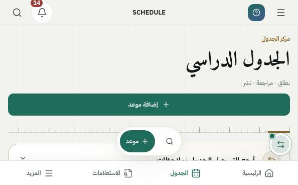 |

لقطة «قبل» لشاشة الدخول أُخذت في هذه الجولة قبل تعديل `49-duo-login.css` (بقية الأوراق معدّلة)، وما تبقّى من `origin/main` مباشرة.

## 8. الفحوص

| الفحص | النتيجة |
|---|---|
| `npm run lint` (`tsc --noEmit`) | PASS |
| `npm run build` كاملاً (فحص PWA والعلامة والدليل وأداؤه، Vite، الخادم) | PASS |
| `npm test -- --quick` (كامل، على جهازٍ يشغّل خادمَي قياس وWebKit معاً) | 268 من 282. الأربعة عشر الفاشلة أُعيد تشغيلها واحداً واحداً: **3** سقطت بسبب هذه الجولة لأنها تطابق نصّ استعلام `@media (max-width:…){` حرفياً (`inbox-studio`، `occupancy-slot-panel`، `approval-bar-visual`) فوُسِّع نمطها ليقبل كتلة الكتاب المضافة ولم يُرخَ ما تحرسه، فنجحت؛ و**2** بسبب ملفات الجولة الجديدة (`presentation-coverage`: سطر `iphone-duo-final` في سجلّ العرض، `srs-doc`: نُقلت أداة القياس من `scripts/` إلى `docs/iphone-duo-final/`) فنجحتا؛ والبقية اختبارات حيّة تشغّل خادمها وتنتظره، نجحت منفردةً (القسم 8.1) |
| `tests/mobile-overflow-css-audit.ts` | 35/35، ومنها فحصان جديدان: إطار التمرير الأفقي كتلةٌ حاوية (انحدار «القاعات × الأوقات»)، وكتلة الكتاب وكعبها |
| مصفوفة WebKit (القسم 4) | 708 مشهداً + 54 (Split View) + 252 لساناً + 114 مشهد نافذة (64 منها فتحت نافذة) + 7 خطوات حيّة + 32 مشهد إجهاد |
| CI على طلب الدمج | يُسجَّل في وصف الطلب |

### 8.1 الاختبارات الحيّة منفردةً

| الاختبار | النتيجة |
|---|---|
| study-proposal-flow | 76/76 |
| section-gap-live | 15/15 |
| student-door | 178/178 |
| radar-insight | 33/33 |
| reference-apply | 54/54 |
| instructor-apply | 29/29 |
| placeholder-action | 14/14 |
| appointment-forms-r2 | 68/68 |
| schedule-wipe | 38/38 |
| inbox-studio / occupancy-slot-panel / approval-bar-visual | 22/22 · 37/37 · 40/40 (بعد توسيع نمط الاستعلام) |
| presentation-coverage / srs-doc | 19/19 · PASS |

سقطت هذه في التشغيل الكامل لأن خوادمها لم تقلع في الوقت المحدد على جهازٍ يشغّل خادمَي قياس وWebKit معاً، كما سجّلت جولة 13 نوفمبر لاختباراتٍ مماثلة.

**خط الأساس:** `origin/main` على الجهاز نفسه: 63/63 مشهداً داخلياً يعبر الكعب، و«القاعات × الأوقات» +414/+146، ولا تمرير أفقي في بقية الشاشات (`before-matrix` و`before-entry` و`before-dialogs` في مجلد القياس).

## 9. ما بقي

**P0:** لا شيء معروف بعد هذه الجولة. («القاعات × الأوقات» أُصلح، ولم يُرَ على جهازٍ حقيقي بعد.)

**P1**
- لم يُختبر على iPhone Duo حقيقي. كل القياس محاكاة WebKit بلا مفصل ولا حواف أمان حقيقية ولا لوحة مفاتيح iOS.
- صفحة العمل في الكتاب عرضها 286px (طولي) و≈430px (عرضي)، فتأخذ ترتيب الهاتف. بعض الشاشات التي تقرّر بـ JavaScript (`isPhoneDevice`: عرضٌ ≥560 وارتفاع ≥480 = مساحة عمل كاملة) تعرض أدوات الحاسوب (أسبوع الجدول القابل للتحرير) في صفحةٍ ضيّقة، فتُمرَّر داخل إطارها. لم يُغيَّر هذا القرار لأنه منطقٌ لا عرض. على 951×585 شبكة الأسبوع فيها 148 خليةً أصغر من 44px.
- الإشعارات وفريقي لم تُقاس (القسم 4.2).

**P2**
- نصٌّ ضيّق في أربع بطاقات (اسم مقرر طويل، «بلا رئيس مسجّل» في المقاعد، اسم قسمٍ طويل في ساعات الأقسام، اسم طالب في كشف التسجيل)، وأزرار أيقونات مقصوصة قليلاً في الجدول على 768×1024 و844×390 (قائمة قبل الجولة).
- فقاعة وارد القاعات تطفو فوق المحتوى في الكتاب كما على الهاتف.
- في الكتاب العرضي تأخذ بطاقة «تجريبي» في الفهرس مساحةً واضحة (حساب العرض التجريبي وحده).
- أهداف لمسٍ <44px قائمة قبل الجولة (القسم 4.1).
- حالة انقطاع الاتصال وصفحات `/me` وصفحات طلب الأستاذ: NOT_TESTED.

## 10. على الجهاز الحقيقي (للمالك)

1. افتح الدوو كتاباً طولياً ثم عرضياً: الفهرس يميناً، العمل يساراً، ولا نصّ ولا زرّ عند المفصل.
2. «مركز الاستعلام» ← «القاعات × الأوقات»: الشبكة تُمرَّر داخل بطاقتها، والصفحة لا تصغر ولا يهرب الجرس.
3. «إضافة موعد»: الأسئلة يميناً و«أسبوع الأستاذ» يساراً، و«✕» يعيد الفهرس.
4. افتح «البحث الشامل» وتفاصيل موعد: يُفتحان على صفحة العمل، والفهرس معتم خلفهما.
5. اطوِ الجهاز ونصف افتحه (طاولة): المحتوى في الأعلى وشريط التنقل في الأسفل لا يغطّي آخر سطر.
6. اكتب في حقلٍ ثم اطوِ وافتح: النص والتمرير باقيان.
7. شغّل المفصل التجريبي في Safari إن أمكن (`viewport-segments`) وتأكد أن الكعب على المفصل.

## 11. إعادة القياس

```bash
npm ci && npm run build            # أو: npx vite build && esbuild server.ts … كما في package.json
DATA_MODE=demo NODE_ENV=production PORT=5120 node dist/server.cjs   # خادمٌ تجريبي محلي
DUO_BASE=http://127.0.0.1:5120 \
NODE_PATH=/opt/node22/lib/node_modules PLAYWRIGHT_BROWSERS_PATH=/opt/pw-browsers \
node docs/iphone-duo-final/duo-book-audit.mjs matrix out.json   # أو live | stress | dialogs | entry | tabs | all
# DUO_POSES=C,D  DUO_ROUTES=/FSchedule/MainReport  DUO_SHOTS=<مجلد اللقطات>
```
الأرقام المقيسة في هذه الوثيقة كلها في `docs/iphone-duo-final/report.json`.

يحتاج `playwright` فيه WebKit. الدخول التجريبي محدود المعدّل: جلسةٌ واحدة لكل تشغيل (أو `DUO_SESSION`).
